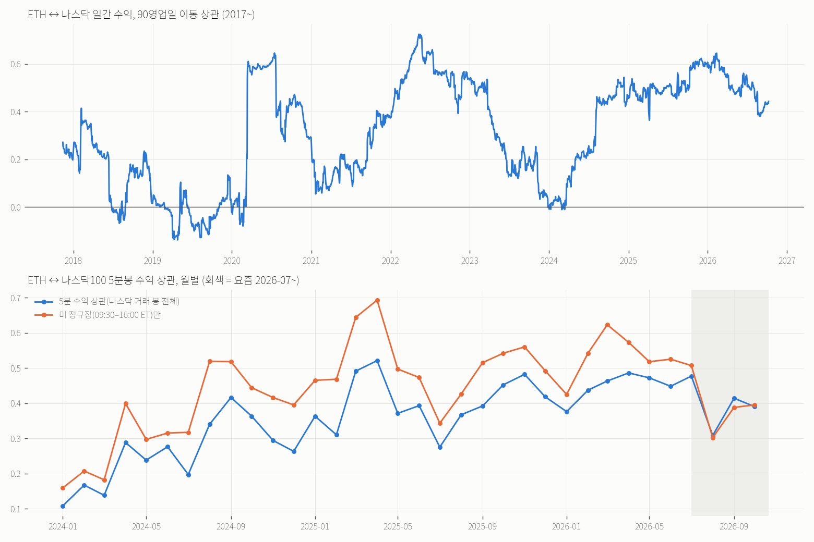
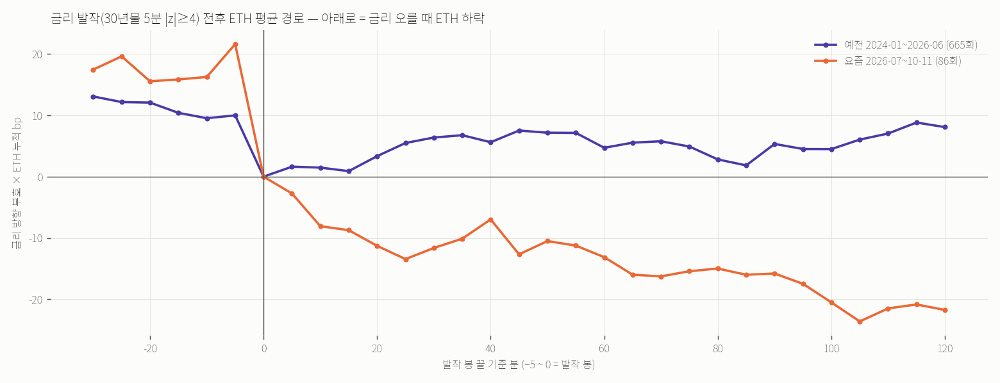

# 나스닥 ↔ ETH 상관 + «금리 발작» 때 ETH 5분봉 반응 (2026-10-13)

사용자: «나스닥과 이더리움 상관관계도 분석해줘. 그리고 요즘에는 금리가 발작하면 이더리움 가격도 급변하던데 타임프레임을 일이 아니라 5분봉으로 봐줘»
스크립트 `scripts/research_eth_nasdaq_rates_5m_20261013.py` · 산출 `tmp/eth_macro5m_20261013/report.json` · 그림 `eth_nasdaq_corr_20261013.png`, `eth_rate_spasm_path_20261013.png`.

## 자료
- 5분봉 2024-01~2026-10-11:
  - 나스닥100 CFD·미 30년 국채 CFD: Dukascopy 1분봉 → 5분
  - ETH: 바이낸스 USDT-M 1분봉 → 5분
- 원천 대조(최근 60일 Yahoo 실제 선물, 같은 봉 상관):
  - 30년 CFD ↔ ZB 0.87, ↔ 10년 ZN 0.78
  - 나스닥 CFD ↔ NQ 0.96
  - 앞뒤 1봉 상관은 0이라 시각이 정확히 맞습니다.
- 일간 장기: FRED 나스닥 종합 + ETH 현물 2017~. 2024~는 나스닥 마감(16:00 ET) 시각의 ETH 가격으로 맞춘 판도 함께 봤습니다.
- Dukascopy 응답이 느려(파일당 6~18초) 5분봉은 2024년부터입니다.

## A. 나스닥 ↔ ETH — 강하게 붙어 있고, 2024년 이후 더 강해졌다
| 단위 | 2017~ | 2022~ | **2025~** | 2026~ |
|---|---|---|---|---|
| 일간 상관 | 0.33 | 0.47 | **0.48** [0.41, 0.55] | 0.45 |
| 일간 민감도(나스닥 1%당 ETH) | 1.27% | 1.40% | **1.47%** | 1.48% |
| 하락일 / 상승일 민감도 | 1.62 / 1.03 | 1.83 / 1.24 | 1.33 / 1.19 | 2.25 / 1.02 |
| 하락 − 상승 차 [10일 블록 95%] | [−0.13, +1.14] | [−0.05, +1.20] | [−0.68, +1.44] | [−0.11, +2.42] |
| 주간 상관 | 0.32 | 0.41 | 0.35 | 0.31 |

- 연도별 일간 상관: 2019 0.00 → 2022 0.57 → 2023 0.18 → 2024 0.37 → 2025 0.50 → 2026 0.45. 2020년 이후로는 «위험자산 한 묶음»입니다.
- 하락일 민감도가 상승일보다 큰 쪽으로 기울지만(2026년 2.25 vs 1.02), **모든 기간에서 차이의 95% 범위가 0을 포함**합니다(10-14 검토 반영 — 처음엔 굵게 단정했다). 5분봉 큰 움직임도 요즘 하락 0.68 / 상승 0.67로 대칭입니다.
- 🔴나스닥 마감(16:00 ET) 시각에 맞춘 일간 상관은 2024~ 0.46 · 2025~ 0.49 인데 **요즘(07~) 0.26 [0.03, 0.52], 민감도 0.64**(71일)로 오히려 약합니다. 5분봉에서는 붙어 있는데 하루 단위로는 덜 붙은 것 — 표본이 짧아 단정하지 않습니다.
- **5분봉 상관은 2024-01 0.11에서 2025~26년 대체로 0.3~0.5로 올라갔습니다**(2025년 월별 0.28~0.52, 그림 아래 칸).
  - 2024~2026-06은 미 정규장 0.46(ETH 5분 변동의 21%를 나스닥이 설명), 그 외 시간 0.26입니다.
  - **요즘(2026-07~)은 정규장 0.40, 그 외 시간 0.41**입니다. 장 밖 시간(야간 선물)에도 똑같이 붙은 것이 새로운 점입니다.
- 선행·지연: 같은 5분봉에서만 상관(0.35~0.40)이 나오고, 앞뒤 1~3봉은 0.00~0.02입니다. **나스닥이 ETH를 5분 앞서 알려 주지 않습니다.** 동시에 움직입니다.
- 나스닥 5분 큰 움직임(±2σ) 봉에서 ETH는 −29 / +28bp였고, 요즘은 −18 / +18bp입니다(대칭).

## B. 금리 발작 → ETH 5분봉 — «요즘 반대로 같이 움직인다»는 체감은 맞다, 대부분 나스닥과 함께
- 정의: 30년물 5분 수익이 직전 5,400 활동 봉(약 23거래일) 표준편차의 4배 이상인 봉입니다.
- 🔴10-14 검토 반영으로 다시 계산했습니다.
  - 앞 봉이 죽어 있던 봉(휴장·주말 재개장 갭 — 처음엔 «18:00 ET 발작» 53건이 전부 이것이었다)을 뺐습니다.
  - 비교 기준을 **같은 구간 안**의 같은 요일·같은 **뉴욕 시각** 5분 칸으로 바꿨습니다(처음엔 전 기간 UTC 칸이라 요즘 값이 낮게 나왔다).
  - 날 단위 평균·하루 첫 발작만 쓴 값을 함께 보고, 회귀는 날 군집 표준오차로 냈습니다.
- 아래 표의 «금리↑ 방향 ETH»는 금리 오르는 쪽을 +로 맞춘 값이라, 음수면 금리가 오를 때 ETH가 내렸다는 뜻입니다.

| | 예전 2024-01~2026-06 | **요즘 2026-07~10-11** |
|---|---|---|
| 발작 횟수 | 665 (326일, 월 22) | 86 (43일, 월 26) — 더 잦아지지는 않았다 |
| 같은 봉 ETH 크기 / 평소 | 42.0 / 18.5bp = **2.3배** [2.0, 2.5] | 28.3 / 12.7bp = **2.2배** [1.7, 3.0] — **같다** |
| 같은 봉 금리↑ 방향 ETH (사건 평균) | −10.0bp [−16.4, −3.3] | **−21.6bp [−30.3, −13.8]** |
| 날 단위 평균 · 반대로 움직인 날 | −14.7bp · 65% | **−21.6bp · 88%** |
| 하루 첫 발작만 · 평소 변동 단위 | −18.0bp · −0.99배 · 66% | **−20.2bp · −2.19배 · 79%** |
| 같은 봉 나스닥(금리↑ 방향) | −2.3bp | **−15.3bp** |
| 이후 2시간 ETH (사건 / 날 단위 · 음수인 날) | +8.1 / −4.3 · 48% (사실상 0) | −21.7 [−42.5, −3.5] / −28.9 · **56%** |
| 채권 고유 몫(나스닥 통제, 날 군집) | b 0.38 [0.19, 0.57] | b 0.08 [−0.35, 0.52] — 예전과 구분 불가 |

- 문턱 3배: 요즘 같은 봉 −15.9bp [−19.9, −12.0], 75%(날 단위 86%) · 예전 −2.0bp(0 포함). 채권 고유 몫은 요즘에도 b 0.32 [0.03, 0.61]로 남습니다.
- 발작 시각은 08:30 ET(지표 발표)가 가장 많고, 10:00·08:35·13:00(입찰) 순입니다.

해석:
1. **«요즘 금리 발작 = ETH 급변»은 방향 면에서 맞습니다.** 예전엔 반대로 움직인 날이 65%, 요즘은 88%입니다. 변동성 단위로는 요즘 발작이 ETH 를 2.2배 세게 반대로 밉니다(−0.99 → −2.19배).
2. 크기 자체(같은 봉 |ETH| 가 평소의 몇 배)는 **두 기간 같습니다**(2.3배 vs 2.2배). 처음 쓴 «오히려 예전이 크다»는 전 기간 UTC 기준선 탓이었습니다(검토 정정).
3. **대부분 나스닥과 함께 움직입니다.** 요즘 발작 봉에서 나스닥이 −15bp로 같이 빠집니다. 다만 처음 쓴 «나스닥이 전부»는 틀렸습니다 — 나스닥을 통제해도 채권 고유 몫이 예전 0.38, 요즘(3배 문턱) 0.32로 남고, 요즘 4배 문턱 0.08 은 표본이 작아 예전 값과 구분되지 않을 뿐입니다.
4. 발작 뒤 2시간 이어짐(−22bp)은 약한 결과입니다. 43일 중 음수인 날이 56%뿐이고, 발작이 몰린 며칠이 평균을 끌었습니다. 예전엔 사실상 0이었습니다. 매매 규칙으로 쓰려면 전진 사전등록이 필요합니다.

## 쓸 곳
- ETH 단기 방향을 볼 때 나스닥(선물)을 같이 띄우는 것이 금리보다 직접적입니다. 다만 같은 5분 안에서 움직이므로 «미리» 알려 주지는 않습니다.
- 요즘 국면에서는 금리 급등 봉(특히 08:30 ET 지표 발표)에 **ETH가 반대로 평균 −20bp, 날 기준 10번 중 9번** 움직입니다. 그 시각 전후로 크기·손절 폭을 보수적으로 잡는 근거가 됩니다(변동성 경계).
- 이 정렬은 2026-07 이후 국면 현상입니다. 2024~25년엔 약했으니 국면이 바뀌면 사라질 수 있습니다.

플래그: fresh_forward_bar_by_bar=true · trade_ledgers_used_as_input=false · future_rows_used_for_entry=false
