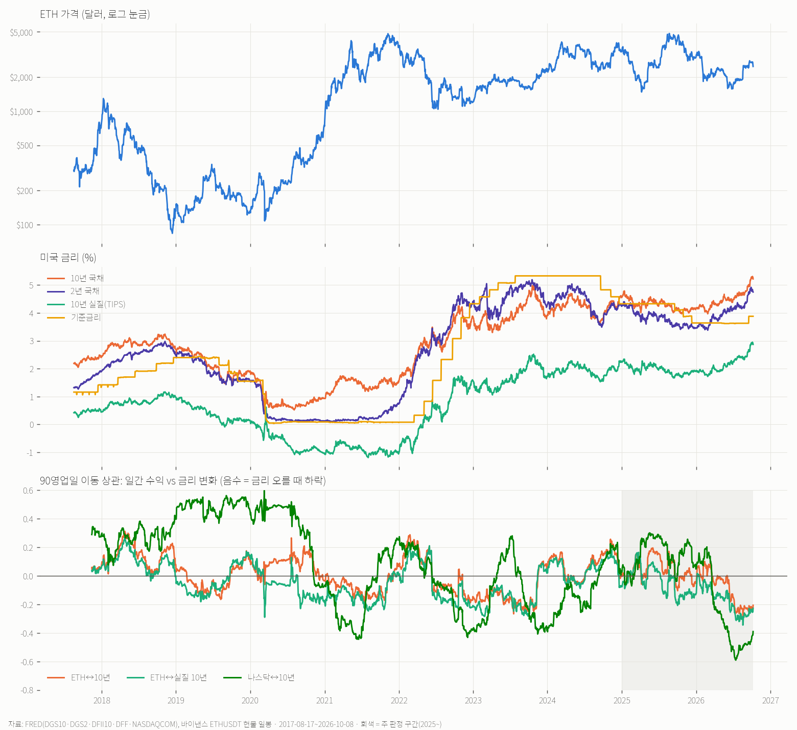
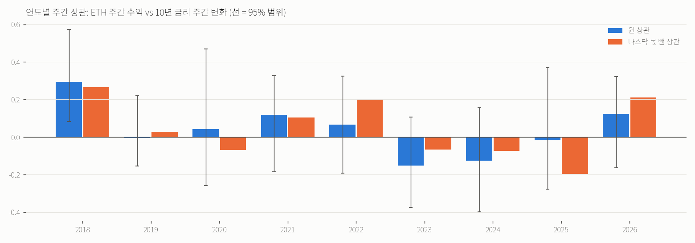

# 금리 ↔ ETH 가격 추이·상관 (2026-10-13)

사용자: «금리와 이더리움 가격 추이와 상관관계 분석해줘»
스크립트 `scripts/research_eth_rates_correlation_20261013.py` · 산출 `tmp/eth_rates_20261013/report.json` · 그림 `eth_rates_trend_corr_20261013.png`, `eth_rates_yearly_corr_20261013.png`.

- 자료: FRED(10년 DGS10 · 2년 DGS2 · 10년 실질 DFII10 · 기준금리 DFF · 나스닥 종합 NASDAQCOM), 바이낸스 ETHUSDT 현물 일봉. 기간은 2017-08-17~2026-10-08이고 금리 발표일은 2,286일입니다.
- 정렬: 미국 날짜 d의 금리와 ETH의 UTC d 종가(20:00 ET)를 짝지었습니다. 주말 수익은 다음 금리일에 합쳤습니다.
- 판단은 **변화량끼리**(ETH 수익률 vs 금리 변화 bp)로만 합니다. 수준끼리의 상관은 추세가 있는 두 계열이면 아무 관계가 없어도 크게 나옵니다(아래 6). 주 판정 구간은 2025년 이후입니다.

## 결론
1. **10년·2년 명목금리는 ETH와 거의 무관합니다.** 2017년 이후 상관은 일간 +0.01, 주간 +0.01, 월간 +0.02이고, 2025년 이후도 0.00 / +0.04입니다. 전부 95% 범위가 0을 포함합니다.
2. **실질금리(TIPS 10년)는 약한 음의 관계가 있습니다.** 2017년 이후 일간 −0.06 [−0.11, −0.01], 주간 −0.13 [−0.26, −0.02], 월간 −0.23 [−0.42, −0.03]입니다. 실질금리가 주간 +10bp 오르면 ETH가 평균 −1.5% 움직였습니다.
   - **다만 실질금리 몫은 대부분 나스닥이 전달한 것입니다.** 나스닥 수익을 빼면 주간 −0.08 [−0.19, +0.03], 월간 −0.01로 사라집니다(«금리 → 주식(위험자산) → ETH»).
   - 🔴10-14 검토 반영 — 반대 방향 숫자도 있습니다: **명목금리**는 나스닥을 빼면 오히려 «금리↑ = ETH↑» 쪽 부분상관이 0을 배제하는 칸이 있습니다 — 월간 10년 2022~ +0.35 [+0.17, +0.52] · 2025~ +0.60 [+0.45, +0.88](21개월) · 월간 2년 2022~ +0.24 [+0.05, +0.40] · 주간 10년 2026~ +0.21 [+0.01, +0.30](41주).
     월간은 표본이 작고(블록 4개월이면 블록 5~14개) 일·주간과 부호가 엇갈려 결론으로 쓰지 않습니다. «금리가 ETH 에 따로 주는 몫»은 **방향이 정해지지 않았다**가 정확합니다.
3. **관계의 부호는 해마다 바뀝니다.** 주간 상관(10년)은 2018 +0.29, 2023 −0.15, 2024 −0.13, 2025 −0.02, 2026 +0.12였고, 2018년을 빼면 모두 범위가 0을 포함합니다.
   - 90일 이동 상관은 지금(10-08) 10년 −0.21, 실질 −0.23으로 최근 몇 달 «금리↑ = ETH↓» 쪽으로 붙어 있습니다. 같은 시기 나스닥↔10년도 −0.39~−0.59로 2022년 이후 가장 강하게 음수입니다(그림 3번째 칸).
   - 10-06 국채선물 분석의 «2026-03~ 동조»와 같은 현상이고, 이번에도 나스닥을 빼면 ETH 고유 몫은 0(2026년 일간 +0.07)입니다.
4. **금리는 ETH를 미리 알려 주지 않습니다.** 이번 주 10년 금리 변화와 다음 1~4주 ETH의 상관은 2017년 이후 −0.05 ~ +0.01입니다(실질금리는 다음 주 −0.07). 이번 달 금리 변화와 다음 달 ETH의 상관은 +0.04 [−0.11, +0.20], 2025년 이후 +0.01입니다. 2025년 이후 주간 지연 상관은 ±0.2로 흔들리지만 부호가 일관되지 않습니다(표본 93주).
5. **금리가 크게 움직인 날도 ETH는 평소와 같습니다.** 10년물이 하루 ±10bp 이상 움직인 날, 상승일 83일의 ETH 평균은 −0.15%(하락 비율 54%), 하락일 78일은 −0.07%(상승 비율 51%)였습니다. 전체 금리일 평균은 +0.09%입니다.
6. **수준 상관은 해마다 −0.91~+0.79로 뒤집힙니다**(예: 기준금리 2018 −0.91, 2017 +0.79). 차트를 겹쳐 보고 «금리 오를 때 코인이 빠졌다»고 읽으면 착시입니다.
- 참고: 월간 2025년 이후는 10년 +0.58 [+0.37, +0.87](21개월)입니다. «금리 오른 달 = ETH 오른 달»이었는데(성장·위험선호 국면), 일·주간과 부호가 다르고 표본이 작아 결론에 넣지 않았습니다.

## 기준금리 국면별 ETH (서술, 표본 작음)
직전 63영업일 기준금리 변화로 국면을 나눴습니다. 인상기는 +25bp 이상, 인하기는 −25bp 이하, 나머지는 동결기입니다.

| 국면 | 일수 | ETH 연율 수익 | 연율 변동 | 구간 |
|---|---|---|---|---|
| 국면 | 일수 | 연율(평균) | 2020-03 뺌 | 일 중앙값 × 252 | 구간 |
|---|---|---|---|---|---|
| 인상기 | 598 | **−47%** | −47% | −28% | 2018-03~12 · 2022-03~2023-10 |
| 동결기 | 1,241 | **+85%** | +86% | +54% | 2019 상반기 · 2020-06~2022-03 · 2023-10~2024-09 · 2025-03~09 · 2026-03~09 |
| 인하기 | 384 | **−71%** | −38% | −40% | 2019-09~2020-01 · 2020-03~06 · 2024-09~2025-03 · 2025-10~2026-02 |

- «금리 인하 = 코인 호재»는 이 표본에서 지지되지 않습니다. 인하기와 인상기는 **둘 다** 음수입니다.
- 🔴10-14 검토 반영: 처음 쓴 «인하기가 가장 나빴다»는 2020-03 한 달(03-12 하루 −59%)에 기댑니다. 그 달을 빼면 인하기 −38%로 인상기 −47%보다 덜 나쁘고, 일 중앙값으로는 다시 인하기가 더 나쁩니다. **둘 사이 순위는 측정 방식에 따라 갈립니다.**
- ETH가 가장 좋았던 때는 금리가 멈춰 있을 때입니다(세 측정 모두).
- 국면마다 구간이 4~6개뿐이라 검정은 아니고 서술입니다.

## 쓸 곳
- 금리를 ETH 방향 신호로 쓰는 근거는 없습니다. 선행도, 큰 금리 날도, 국면 조건부도 마찬가지입니다.
- 금리가 움직인 날 ETH가 같이 움직이는 것은 «나스닥이 같이 움직였기 때문»입니다. 화면에서는 금리보다 나스닥 선물을 보는 편이 직접적입니다.
- 최근 몇 달처럼 «금리↑ = 주식↓» 국면에서는 금리 급등 지표 발표(CPI·고용) 시각의 변동성 경계용으로만 의미가 있습니다. 대시보드의 국채선물 4종 1분 차트(10-06)가 그 용도입니다.
