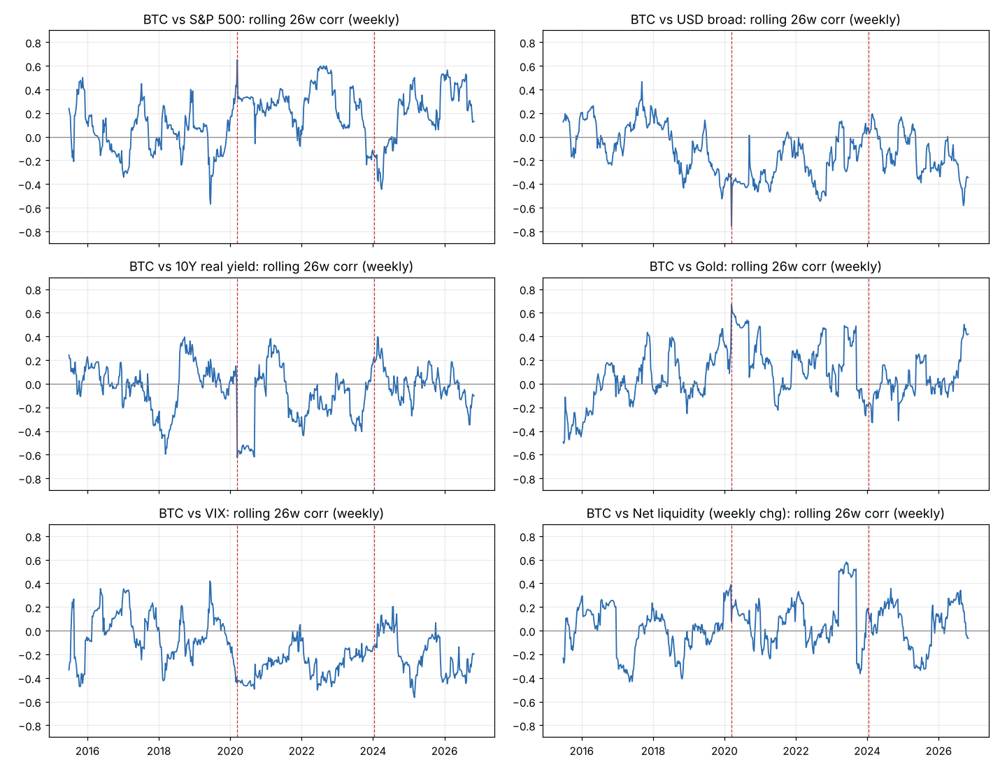
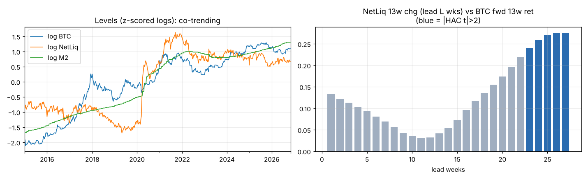

# 매크로 ↔ 코인 동조/역행 지표 전수 분석 (2026-10-27)

> **연구용 진단 문서다.** 아래 숫자는 주봉/일봉 research score이며, CLAUDE.md의 Fresh-Forward 규칙(5분봉 bar-by-bar) 기준 승격·라이브 근거가 아니다.
> 재현: `scripts/research_macro_crypto_panel_20261027.py` → `scripts/research_macro_crypto_correlation_20261027.py`.
> 산출물: `docs/experiments/macro_crypto_correlation_20261027/` (CSV 12개 · PNG 3개 · provenance.json).

## 0. 한 장 요약

**결론 3줄**
1. 매크로 지표는 코인과 **같이 움직이지만(동행), 앞서 움직이지는 않는다(선행 거의 없음).** 동행 상관도 약하다. 매크로 전체를 합쳐도 BTC 주간 변동의 **6%**(2015–26)를 설명하고, 2020년 이후로 한정해도 **14–15%**다. 나머지 85% 이상은 코인 고유의 변동이다.
2. 일관되게 **같은 방향**으로 움직인 지표는 미국 주식(S&P500), 기대인플레(10Y BEI), 금이다. 일관되게 **반대 방향**은 VIX, 신용스프레드(HY OAS·Baa), 달러(광의 달러지수·원/달러), 금융여건지수(NFCI)다. 2020년 이전에는 사실상 모든 상관이 0이었다.
3. "글로벌 M2/순유동성이 BTC를 10~12주 선행한다"는 주장은 이 데이터로는 **재현되지 않는다.** 수준(level) 상관 0.93은 추세를 공유해서 생긴 가짜 상관이다. 무작위 랜덤워크 28%가 log M2와 |r|>0.8을 낸다. 유일하게 기간마다 버틴 선행 신호는 **"직전 13주 달러 약세 → 다음 4주 BTC 강세"** 레짐 효과다. 이마저도 선형 표본외 R²는 1% 안팎이다.

**지표별 판정표** (주간 Pearson r, 괄호는 HAC t. ALL=2015-01~2026-10, P1=2015–19, P2=2020–2024-01-10, P3=현물 ETF 승인 2024-01-11 이후)

| 지표 | 방향 | ALL | P1 | P2 | P3 | 일간 ALL / P3 | 월간 ALL | 연도별 부호 일치 | 선행성 |
|---|---|---|---|---|---|---|---|---|---|
| **S&P500** | 동행(+) | **0.18** (4.1) | 0.06 | 0.29 | 0.22 | **0.24 / 0.34** | **0.36** | 10/12년 + | 없음 |
| **10Y 기대인플레(BEI)** | 동행(+) | **0.17** (2.9) | 0.02 | 0.27 | 0.24 | 0.08 / 0.14 | 0.25 | 8/12 + | 없음 |
| KOSPI | 동행(+) | 0.16 (2.9) | 0.07 | 0.32 | 0.09 | 0.03 / 0.08 | 0.12 | 11/12 + | 없음 (일간은 1일 시차가 동행) |
| EUR/USD | 동행(+) | 0.12 (2.7) | 0.07 | 0.18 | 0.09 | 0.07 / 0.05 | 0.13 | 9/12 + | 약함 |
| 금(GC=F) | 동행(+) 약 | 0.08 (1.5) | −0.02 | 0.21 | 0.08 | **0.10 / 0.15** | 0.04 | 9/12 + | 없음 |
| 브렌트유 | 동행(+) 약 | 0.10 (1.8) | 0.05 | 0.19 | 0.01 | 0.06 / 0.01 | 0.20 | 7/12 + | 없음 |
| 스테이블코인 공급 | P3만 동행 | −0.02 | −0.04 | 0.06 | **0.24** (2.1) | 0.00 / 0.20 | −0.14 | 6/12 | **BTC가 공급을 선행** |
| **VIX** | 역행(−) | **−0.16** (−3.6) | −0.06 | −0.28 | −0.21 | **−0.19 / −0.33** | −0.22 | 10/12 − | 없음 |
| **HY OAS (2023+)** | 역행(−) | −0.18 (−2.6) | – | – | −0.20 | **−0.24 / −0.26** | −0.36 | – | 없음 |
| **NFCI(금융여건)** | 역행(−) | **−0.18** (−4.4) | −0.18 | −0.22 | −0.24 | – | −0.28 | 10/12 − | 착시(§6) |
| Baa−10Y 스프레드 | 역행(−) | −0.14 (−2.7) | −0.06 | −0.21 | −0.11 | −0.06 / −0.11 | −0.28 | 8/12 − | BTC가 1주 선행(가격 갱신 지연 착시) |
| **달러(광의 지수)** | 역행(−) | **−0.14** (−3.0) | −0.01 | −0.26 | −0.16 | −0.11 / −0.12 | −0.18 | **10/12 −** | **13주 레짐 효과(§7)** |
| **원/달러** | 역행(−) | −0.12 (−2.7) | −0.02 | −0.20 | **−0.22** | −0.06 / −0.13 | −0.14 | 9/12 − | 없음 |
| 10Y 실질금리(TIPS) | 역행(−) 약 | −0.09 (−1.5) | 0.01 | −0.19 | −0.03 | −0.05 / −0.02 | −0.16 | 9/12 − | 약한 표본외(§8) |
| 연방기금금리 | 역행(−) 약 | −0.09 (−1.9) | −0.02 | −0.15 | −0.06 | 0.00 | −0.05 | – | 없음 |
| 미 국채 2Y/10Y 명목 | ≈0 | 0.01 / 0.02 | – | – | 0.08 / 0.09 | ≈0 | ≈0 | 반반 | 없음 |
| 엔/달러(USDJPY) | ≈0 | −0.05 | −0.05 | −0.03 | −0.10 | −0.01 | −0.08 | 8/12 − | Granger p=0.04(약함) |
| 연준 대차대조표 | ≈0 | 0.02 | −0.07 | 0.06 | −0.10 | – | 0.00 | 3/12 + | 2020 QE 1회 사건 |
| 순유동성(WALCL−TGA−RRP) | ≈0 | 0.06 (1.4) | 0.00 | 0.14 | 0.01 | – | 0.12 | **6/12 (동전던지기)** | 기간마다 부호 반전 |
| 미국 M2 | ≈0 | – | – | – | – | – | 0.08 (1.3) | – | **재현 안 됨** |

굵은 글씨: 주간 ALL |t|≥2.5이고, P2와 P3 모두 |r|≥0.15에 같은 부호인 지표다(HY OAS는 2023+만). ETH도 방향은 같고 크기는 대체로 조금 더 크다. 일간 ALL 기준 S&P500 0.31, VIX −0.27, HY OAS −0.28, 달러 −0.17, 금 0.12다(`A_correlations.csv`, asset=ETH).

## 1. 데이터 (전부 외부 공개 데이터)

이 세션의 네트워크 정책이 FRED·Yahoo·Binance·DefiLlama 같은 원천 API를 모두 차단한다(`api/fred/...` CONNECT 403). 그래서 **원시 관측치를 커밋해 두는 공개 GitHub 저장소**에서 받았고, 커밋 해시를 `provenance.json`에 남겼다.

| 소스 | 내용 | 범위 |
|---|---|---|
| `pk-claude/siberforge.xyz` `data/fred/*.json` (3331cd1) | FRED 원 시리즈. 금리(DGS2/10, DFII10, T10YIE, T10Y2Y, THREEFYTP10, DFF, SOFR), 신용(BAA10Y, BAMLH0A0HYM2), 여건(NFCI + 하위 3종), VIX, 달러/FX(DTWEXBGS, DEXJPUS, DEXCHUS, DEXUSEU), 유가, 구리, 유동성(WALCL, WTREGEN, RRPONTSYD, WRESBAL, M2SL), 월간 거시 | 2000~2026-10-26 |
| `Mario-SO/ohlcv` (85cf3ec) | Yahoo 일봉 BTC-USD, ETH-USD, ^GSPC, GC=F | BTC 2014-09~2026-10-22 |
| `coinmetrics/data` csv | BTC/ETH PriceUSD(교차검증), USDT/USDC/DAI/BUSD `SplyCur` | ~2026-05-23 |
| `LEEYOUNGJIN-GIT/fred-macro-review` (21b8c31) | KOSPI, USD/KRW(DEXKOUS), STLFSI4, HY OAS(보강) | ~2026-10-26 |

정합성 확인 결과:
- Yahoo와 Coin Metrics의 BTC 일간 수익률 상관은 **0.986**이고, 가격 수준 차이는 중앙값 0.17%다.
- Yahoo ^GSPC와 FRED SP500의 일간 수익률 상관은 **0.9997**이다.
- 순유동성 단위는 WALCL[백만$] − WTREGEN[백만$] − RRPONTSYD[십억$]×1000이다.

**확보하지 못한 것(한계)**:
- 글로벌 M2: 미국 M2만 있다. ECB/BOJ/PBoC 원천이 차단됐다.
- 현물 ETF 자금흐름: 찾은 미러(`firemansghost/grayghost-risk`)는 2024-01-11~02-08의 21일치에서 멈춰 있어 버렸다.
- DXY 원지수: 광의 달러지수 DTWEXBGS로 대체했다.
- MOVE 지수, 나스닥: S&P500으로 대체했다.
- 공포탐욕지수, 펀딩/OI 장기 이력: 미러가 없다.
- HY OAS: FRED 라이선스 때문에 2023-10 이후만 있다. 그래서 장기 신용 지표는 Baa−10Y를 썼다.
- 스테이블코인: 2026-05까지만 있다.

## 2. 방법

- **변환**: 가격류는 100·Δlog, 금리·스프레드는 Δ(bp), 지수류(NFCI 등)는 Δ로 썼다. 상관은 전부 **변화율끼리** 계산했다. 수준끼리 상관을 구하면 추세 공유 때문에 가짜 상관이 나온다(§5).
- **주기**:
  - 일간: 미국 영업일 그리드를 썼다. 주간·월간에만 나오는 시리즈를 일간에 ffill로 번지게 두지 않았다.
  - 주간: W-FRI, 금요일 종가 기준이다.
  - 월간: 월말 기준이다.
- **시각 정렬 주의**: Yahoo BTC 일봉 종가는 다음날 00:00 UTC다. 미 증시 마감보다 3~4시간 늦어서, 일간 "같은 날" 상관에는 BTC가 정보를 몇 시간 더 본 상태가 섞인다. ±1일 교차상관(§4)으로 영향을 확인했고 미미했다. 다만 주간 상관이 일간보다 작게 나온다(S&P 0.18 vs 0.24). BTC의 주말 움직임이 주간 수익률에 노이즈로 들어가기 때문이다.
- **추론**:
  - 표준화 회귀의 Newey-West HAC t(일간 lag 5, 주간 4, 월간 3)와 Fisher-z 95% CI를 함께 봤다.
  - 겹치는 다기간 수익률에는 HAC lag를 H+13으로 잡았다.
  - **다중검정**: 교차상관만 1,882개를 검정했다. 그래서 |z|>3이 우연히도 약 5개는 나온다고 보고 해석했다.
- **기간 분할**: P1(기관 이전), P2(코로나 유동성·2022 긴축), P3(현물 ETF 승인 이후)로 나눴다.
- **표본외 검증**: 2018-01부터 확장 윈도 OLS로 예측했다. 학습 표본은 타깃이 실현된 시점까지만 쓴다. 비교 기준은 과거 평균(Campbell-Thompson R²_OS)이고, Clark-West t로 검정했다. 예측변수는 모두 공표 지연을 감안해 1주 시차를 뒀다.

## 3. 동행 상관: 무엇이, 언제, 얼마나 (`A_*`, `B_*`)



- **2020년 3월이 구조적 단절점이다.** P1(2015–19)에서는 S&P500과의 일간 상관이 0.02였고 거의 모든 지표가 |r|<0.1이었다. 이 시기 BTC는 매크로와 무관한 자산이었다. P2부터 S&P500 0.39(일간), VIX −0.34, 달러 −0.23으로 뛰었다. IMF(2022) 수치인 2017–19 0.01 → 2020–21 0.36과 거의 같다.
- **ETF 이후(P3)에도 동조는 유지됐다.** 일간 기준 S&P500 0.34, VIX −0.33, HY OAS −0.26, 원/달러 −0.13, 스테이블코인 공급 +0.20이다. 주식 상관은 롤링 기준으로 −0.4~+0.6을 오가서 고정값으로 쓸 수 없다(`B_rolling_daily_btc_spx.png`).
- **달러**는 연도별로 12년 중 10년이 음수였다. 2020년 −0.41, 2022년 −0.28, 2025년 −0.30이다. 반대로 **실질금리**는 연도별 부호가 섞이고 크기도 작다(ALL 주간 −0.09). 2022년 언론에 돌던 "BTC–TIPS 상관 −0.95"는 수준끼리 상관이었고, 변화율로 보면 2022년에도 −0.09에 그친다.
- **금**은 일간 0.10, 연도별 9/12년 양수로 약한 양의 동행이다. 2020년(0.46) 같은 위기 국면에서만 크게 튄다. "디지털 금"이라 부를 만한 강도는 아니다(Baur & Hoang의 ≈0 결과와 부합).
- **기대인플레(BEI)는 양(+), 실질금리는 음(−)** 이다. 명목금리 변화를 두 성분으로 나누면 BTC는 "리플레이션 기대 상승"에는 같이 오르고 "실질 긴축"에는 내린다. 명목 10Y는 두 성분이 상쇄돼 ≈0이 된다.
- **월간 주기에서는 신용·스트레스가 가장 강하다.** St. Louis 스트레스지수 −0.30, Baa −0.28, NFCI −0.28, HY OAS −0.36(2023+), S&P500 +0.36이다.

## 4. 리드-래그: 매크로가 코인을 앞서는가? (`C_leadlag.csv`, `D_granger_weekly.csv`)

- **일간**: 거의 모든 지표에서 상관이 lag 0에만 몰려 있고, ±1~3일 상관은 |r|≤0.05다. KOSPI만 "BTC(t) vs KOSPI(t+1)" 상관(0.09)이 같은 날 상관(0.03)보다 크다. BTC 일봉은 09:00 KST에 마감하고 한국장은 그 직후에 열려 전날 미국·코인 움직임을 반영하기 때문이다. 시간대 차이일 뿐 실질적으로는 동행이다.
- **주간 Granger(4 lag, 114개 검정)**:
  - 매크로→BTC로 p<0.05가 나온 것은 NFCI/NFCI-risk, USDCNY, USDJPY, 2s10s(P3) 정도다.
  - **반대 방향(BTC→매크로)이 더 많고 더 강하다.** S&P500(p=0.001), St. Louis 스트레스지수(p<0.0001), Baa 스프레드(p=0.007), 스테이블코인 공급(p=0.003), 연준 대차대조표(p=0.025)가 여기에 해당한다.
- 이 중 상당수는 착시다.
  - **Baa 스프레드**: S&P500도 다음 주 Baa 스프레드와 −0.21로 상관한다. BTC 고유 정보가 아니라 회사채 호가가 늦게 갱신되는 문제다.
  - **NFCI**: 주간 변화의 자기상관이 0.945로, 평활(smoothing)·사후개정된 현재 빈티지다. 과거 값에 미래 정보가 섞여 있어 **선행지표로 쓰면 누수**다(CLAUDE.md의 사건 라벨 경계 계약과 같은 부류). 쓰려면 ALFRED 실시간 빈티지가 필요하다.
  - **스테이블코인**: BTC 상승 2~7주 뒤 공급이 늘어난다(+0.12~0.14, 세 기간 모두 +0.13 안팎). **수요가 발행을 이끄는 구조**다. 반대로 공급이 BTC를 1주 선행하는 상관은 P1 −0.22, P3 +0.16으로 부호가 뒤집혀 신호가 아니다.

## 5. 유동성(M2·순유동성·연준 대차대조표) 선행 주장 검증 (`G_*`)



| 비교 (월간, 2015–2026) | 수준 상관 | 1개월 변화 | 12개월 변화 |
|---|---|---|---|
| log BTC vs log M2 | **0.93** | 0.09 | 0.25 |
| vs 순유동성 | 0.76 | 0.13 | 0.38 |
| vs 연준 대차대조표 | 0.71 | −0.00 | 0.10 |
| vs S&P500 | 0.92 | 0.35 | 0.59 |
| vs 달러지수 | **+0.66** | −0.15 | **−0.52** |

- 수준 상관 0.93은 의미가 없다. **랜덤워크 2,000개 중 28%가 log M2와 |r|>0.8**을 낸다(중앙값 0.63). 달러는 수준으로는 +0.66인데 변화율로는 −0.52로 **부호가 뒤집힌다.** 수준 상관을 근거로 한 주장이 왜 위험한지 보여주는 예다.
- **미국 M2 YoY → BTC 다음 3개월**: 선행 4~56주 어디에서도 전체 기간 |t|<2였다. 13주 선행에서 r=+0.06(t=0.4)이다. P2·P3 부분기간에서는 오히려 **음(−)** 이다. 2020–21 M2 폭증 뒤 2022 폭락이라는 사이클 하나가 지배하는 결과다.
- **순유동성 13주 변화 → BTC 다음 13주**:
  - 전체 기간에서는 선행 26주에서 r=0.28(t=2.2)이 최대다. 이는 2020 QE → 2020–21 강세장이라는 사건 하나 때문이다.
  - P3에서는 선행 1~4주 r=+0.40~0.43(t=4.1)이지만, 선행 15~22주에서는 −0.12~−0.20으로 **부호가 바뀐다.** 2.8년치에 13주 겹침 수익률이라 독립 관측은 약 11개뿐이다.
  - "최적 시차"가 기간마다 다르다(26주, 2주, 27주). 문헌의 "10~12주 선행"은 시차를 골라 맞춘 결과일 가능성이 높다.
- **연도별 주간 상관**: 순유동성은 6/12년 양수로 동전던지기, 연준 대차대조표는 3/12년 양수다.
- **규칙 검증(§7)**: "순유동성 13주 증가 상위 1/3일 때만 보유"는 P2에서 Sharpe 1.22였지만, P3에서는 **0.05(B&H 0.51)** 로 무너졌다.

## 6. 꼬리(폭락) 국면의 동조 (`F_tail_conditional_daily.csv`)

| 일간, 전체 기간 | n | BTC–SPX 상관 | BTC의 SPX 베타 | BTC 하락 확률 |
|---|---|---|---|---|
| SPX 하위 10% 날 | 298 | **0.37** | **1.72** | 64% |
| SPX 중간 80% 날 | 2379 | 0.09 | 0.70 | 47% |
| SPX 상위 10% 날 | 298 | 0.20 | 0.69 | 30% |
| VIX 급등 상위 10% 날 | 298 | 0.36 | 1.60 | 58% |
| 하방 반베타(SPX<0) / 상방(SPX>0) | | 0.25 / 0.14 | **1.20 / 0.67** | |

- **하방 비대칭이 있다.** 주식이 크게 빠지는 날 BTC는 같이, 더 크게 빠지고, 오르는 날에는 덜 따라 오른다. P2의 SPX 하위 10% 날은 상관 0.52, 베타 2.03, 하락 확률 74.5%였다. VIX 급등일은 0.57, 금과의 상관 0.42, 달러와의 상관 −0.49였다. 위기일에는 "금↑·달러↓·BTC↓"가 아니라 **BTC가 위험자산 묶음으로 같이 매도된다.**
- **P3(ETF 이후)에서는 이 비대칭이 사라졌다.** SPX 하위 10% 날 상관 0.05, 베타 0.18이고, 반베타도 0.99 / 1.05로 대칭이다. 2024년 8월 엔캐리 청산처럼 주식과 따로 폭락한 날, 주식이 빠져도 BTC가 버틴 날이 섞여서다. 다만 하락 확률은 여전히 70%다.

## 7. 레짐 조건부: 유일하게 버틴 선행 효과 = 13주 달러 약세 (`H_*`, `J_*`)

직전 13주 지표 변화를 **확장 윈도 3분위**로 나눴다(미래 분위 미사용, 1주 공표 시차). 셀 값은 해당 구간에서 BTC의 다음 4주 평균 로그수익률(%)이다.

| 상태 | 기간 | 하위 1/3 | 중간 | 상위 1/3 |
|---|---|---|---|---|
| **달러 13주 변화** | 2015–19 | **+12.7** | +3.2 | +2.4 |
| | 2020–23 | **+13.2** | −1.9 | −1.1 |
| | 2024–26 | **+5.7** | +0.5 | −0.6 |
| | 전체 | **+11.2** (t=4.8, 적중 72%) | +0.7 | +0.8 |
| 실질금리 13주 변화 | 전체 | +6.3 | +5.9 | +0.6 |
| 순유동성 13주 변화 | 전체 | +2.2 | +2.3 | +8.6 (P3 +7.6, n=24) |

- **세 기간 모두 같은 방향으로 나온 것은 달러뿐이다.** 상위−하위 차이는 −10.4%p(t=−2.7)다.
- **BTC 자체 모멘텀으로 설명되지 않는다.** 13주 BTC 수익률을 통제해도 달러 계수는 −0.17(t=−2.7)로 거의 그대로다. 주식·금·실질금리·순유동성까지 넣으면 −0.28(t=−3.8)로 오히려 커진다.
- **주간 보유 규칙**(달러 약세 하위 1/3 주에만 보유, 비겹침 1주 수익률):

  | 기간 | 규칙 Sharpe | B&H Sharpe |
  |---|---|---|
  | 2015–19 | 0.99 | 0.88 |
  | 2020–23 | 1.17 | 0.64 |
  | 2024–26 | 0.74 | 0.51 |

  노출은 약 30%이고, 연수익은 B&H보다 낮다. 수익을 키우는 신호가 아니라 **위험 대비 효율을 높이는 필터**다.
- **선형 표본외 예측력은 작고 불안정하다.** 달러 13주 → 4주 R²_OS +0.81%(CW t=1.83)인데, 부분기간으로 보면 2018–19 −1.4%, 2020–23 +2.9%, 2024–26 −1.2%다. 효과는 극단 구간에만 몰린 **비선형 레짐 효과**이고, 선형 회귀로 뽑아내면 사라진다.
- **현재 판독(데이터 마감 2026-10 말)**: 달러 13주 +1.34%(상위 1/3 경계 1.30 초과), 실질금리 13주 +19bp(상위 1/3), 순유동성 13주 −0.4%(중간)다. 역사적으로 BTC 다음 4주 평균이 약 +0.6~0.8%로 **가장 밋밋했던 구간**이다. 예측이 아니라 분포 위치를 보여주는 것이다.

## 8. 표본외 예측력 종합 (`I_*`, `J_momentum_control_and_oos13w.csv`)

- **4주 변화 예측변수 19개 + 전부 투입(kitchen sink) + 단순평균 결합**을 검증했다. 1주 앞 예측에서 R²_OS가 양수인 것은 순유동성(+0.35%, CW t=1.4)과 스테이블코인(+0.19%, CW t=1.9)뿐이다. 4주 앞에서는 금(+0.89%), 스테이블코인(+0.49%, CW t=2.08), 순유동성(+0.49%)이다. **나머지는 모두 과거 평균보다 못했고**, 전부 투입한 모형은 −15%~−45%였다.
- **13주 변화 기준**(4주 앞)으로는 EUR/USD +2.34%(CW t=2.46), 실질금리 +1.12%(CW t=1.85), 달러 +0.81%(CW t=1.83)가 양수였다.
  - EUR/USD와 달러는 2020–23 한 구간에서만 양수였다(EUR/USD +6.5%, 나머지 −1.9 / −1.7%).
  - **세 부분기간 모두 양수였던 것은 실질금리뿐**이다(+0.9 / +1.3 / +1.1%). 그마저도 크기는 1% 수준이다.
- 결론적으로 매크로는 **현재 BTC가 왜 움직이는지 설명해 주지만, 다음 움직임을 맞추지는 못한다.** 문헌과 같다: Liu & Tsyvinski(RFS 2021)는 거시 노출이 없다고 봤고, NY Fed Benigno & Rosa(2023)는 매크로 뉴스 창에서 BTC 반응이 0이라고 했다.

## 9. 문헌 대조

웹 접근이 막혀 논문 본문은 읽지 못했다. 검색 스니펫 기준이다. [R]은 중앙은행·IMF·동료심사, [I]는 업계, [M]은 마케팅·시차 맞추기다.

| 주장 | 문헌 | 이번 측정 | 판정 |
|---|---|---|---|
| BTC–S&P 상관 2017–19 ≈0 → 2020–21 0.36 | [R] IMF 2022 | P1 0.02 → P2 0.39(일간) | **일치** |
| BTC–DXY 일간 −0.1~−0.2, 레짐 따라 부호 변화 | [I] CoinDesk/Coin Metrics | ALL −0.11, P2 −0.23, 연도별 10/12 음 | 일치(이번 측정이 더 안정적) |
| 금 상관 ≈0, 위기 때만 급등 | [R] Baur & Hoang, KC Fed | 0.10, 2020년 0.46 | 일치 |
| BTC–실질금리 −0.95(2022) | [I] CoinDesk/Fortune | 변화율 기준 2022년 −0.09 | **수준 상관 착시** |
| Fidelity: 실질금리와 +0.6 기록적 양상관(2026-10) | [I] | 2026 연간 주간 −0.04 | 수준 상관으로 추정, 재현 안 됨 |
| 글로벌 M2 10~12주 선행, 수준 상관 0.94 | [M] Lyn Alden 외 | 미국 M2 선행 미재현, 수준 0.93은 랜덤워크 28%도 달성 | **기각(미국 M2 기준)** |
| CF Benchmarks: M2–BTC 관계 2025Q4 붕괴 | [I] | P3 M2 YoY → BTC 음(−) | 일치 |
| 스테이블코인 발행은 수요 추종 | [WP] BIS WP1219, Griffin-Shams | BTC→공급 +0.13(전 기간), Granger p=0.003 | **일치** |
| 위기 때 주식 동조 상승 | [R] ECB FSR 2022, IMF WP23/213 | P2 SPX 폭락일 0.52, VIX 급등일 0.57 | 일치. P3에서는 약화 |
| 통화정책 쇼크가 크립토 위험선호를 낮춤 | [WP] IMF WP/23/163 | 연방기금금리 주간 −0.09, 실질금리 −0.09 | 방향 일치, 크기 작음 |
| 매크로로 표본외 예측 거의 불가 | [R] Liu-Tsyvinski, [WP] 2026 논문들 | 4주 변화 기준 21개 중 R²_OS>0은 2~3개(모두 1% 미만). 13주 기준 최대 2.3%지만 부분기간 일관성은 실질금리 하나뿐 | **일치** |

## 10. 이 저장소(스캘핑 봇)에 주는 시사점

1. **5분봉 진입 피쳐로서 매크로의 가치는 낮다.** 일 단위 동행 상관도 0.1~0.3이고 선행이 없다. 일간 FRED 값은 미국 장 마감 뒤에야 확정되므로 그날 장중에는 알 수 없다. 넣는다면 **전일까지 확정된 값**만 써야 한다. NFCI 같은 개정·평활 시리즈는 금지다. ALFRED 빈티지 없이 쓰면 누수다(§4).
2. **레짐·리스크 필터로는 쓸 만하다.**
   - 13주 달러 변화가 하위 1/3이면 위험을 늘리고, 상위 1/3이면 줄이는 방식은 세 기간 모두 Sharpe를 개선했다.
   - VIX 급등일·SPX 폭락일 조건부로 롱 노출을 줄이는 방식은 P2까지 강했고 P3에서 약해졌다.
   - 다만 이 저장소의 승격 규칙(fresh-forward 5분봉 bar-by-bar)으로 다시 검증하기 전까지 **research score**일 뿐이다.
3. **유동성 선행 지표(M2·순유동성)를 모델 입력이나 서사로 쓰는 것은 근거가 약하다.** 기간마다 최적 시차와 부호가 바뀐다.
4. 바로 실험해 볼 만한 것:
   - (a) 미국 장 시간대의 S&P 선물과 VIX 선물을 실시간 동행 리스크오프 감지에 쓰기(이 데이터셋에는 없음)
   - (b) 13주 달러 레짐을 기존 사이징 사이드카의 margin_fraction 축소 조건으로 넣었을 때 fresh-forward 성과
   - (c) 글로벌 M2와 ETF 흐름은 네트워크를 허용한 뒤 재측정(§1 한계)

## 11. 재현

```bash
# 외부 미러 (네트워크 정책상 GitHub만 허용됨)
mkdir -p /tmp/claude-0/ext/cm && cd /tmp/claude-0/ext
for r in pk-claude/siberforge.xyz Mario-SO/ohlcv LEEYOUNGJIN-GIT/fred-macro-review; do git clone --depth 1 https://github.com/$r $(echo $r|tr / _); done
for a in btc eth usdt usdc dai busd; do curl -sSo cm/$a.csv https://raw.githubusercontent.com/coinmetrics/data/master/csv/$a.csv; done
cd /home/user/crypto-scalping
python3 scripts/research_macro_crypto_panel_20261027.py --ext-dir /tmp/claude-0/ext
python3 scripts/research_macro_crypto_correlation_20261027.py
```

산출물 색인: `A_correlations.csv`(640행: 자산×주기×기간×지표), `B_yearly_weekly_corr_BTC.csv`, `C_leadlag.csv`, `D_granger_weekly.csv`, `E_multivariate_weekly.csv`, `E_partial_corr_ex_spx.csv`, `F_tail_conditional_daily.csv`, `G_liquidity_lead.csv`, `H_regime_conditional.csv`, `I_oos_predictability.csv`, `J_regime_robustness.csv`, `J_momentum_control_and_oos13w.csv`, `provenance.json`.
`panel_daily.parquet`(원시 패널)는 Coin Metrics의 CC BY-NC 등 제3자 원자료라 커밋하지 않았다. 위 재현 명령으로 다시 만든다.
